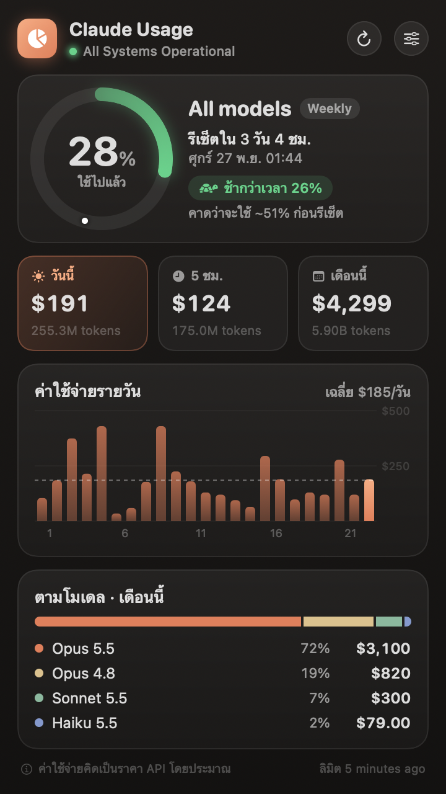

# Claude Usage Bar

A small macOS menu bar app that shows how much of your Claude plan you've used, plus what your Claude Code sessions would have cost at API prices.

แอปเล็กๆ บนเมนูบาร์ macOS ที่บอกว่าใช้ลิมิตแพลน Claude ไปแล้วกี่ % และ Claude Code ใช้ไปเท่าไหร่ ถ้าคิดเป็นราคา API

<p align="center"></p>

> **Unofficial.** Not affiliated with, endorsed by, or supported by Anthropic. "Claude" is a trademark of Anthropic.
>
> **ไม่ใช่แอปทางการ** ไม่ได้เกี่ยวข้องกับ Anthropic

## Features

- **Plan limits**: the 5-hour session and weekly limits (plus Opus/Sonnet weekly and extra usage, when your plan has them), with the reset countdown
- **Pace**: shows whether you're using the limit faster or slower than time is passing, and an estimate of where you'll be at reset
- **Claude Code usage** from your local logs (`~/.claude/projects`): today, last 5 hours, this month, a daily cost chart and a per-model breakdown
- **Claude status** from status.claude.com
- Menu bar shows a progress ring with the %, or today's cost / tokens
- Starts at login, refreshes on its own, gentle on the API: plan limits are fetched every 10 minutes (or when you open the menu and they're over 3 minutes old), cached across restarts, with back-off on HTTP 429

## Install

Requires macOS 14 or later. Works on Apple Silicon and Intel.

### Option A: download

1. Download `ClaudeUsageBar.zip` from [Releases](../../releases) and unzip it.
2. Move **Claude Usage.app** to `/Applications`.
3. The app isn't signed with an Apple Developer ID, so the first time: **right-click → Open → Open**.
   If macOS still refuses, run `xattr -dr com.apple.quarantine "/Applications/Claude Usage.app"`.

To start it at login with this option, add it in **System Settings → General → Login Items**.

### Option B: build from source (recommended)

Needs the Xcode Command Line Tools (`xcode-select --install`).

```bash
git clone https://github.com/Netizen-alt/claude-usage-bar.git
cd claude-usage-bar
./install.sh
```

`install.sh` builds the app, copies it to `/Applications` and adds a LaunchAgent so it starts at every login (and restarts if it crashes; choosing Quit still closes it).

Uninstall:

```bash
./install.sh --uninstall
```

## Plan limits & your login

To show plan limits, the app reads the Claude Code login that Claude Code itself stores in your macOS Keychain (`Claude Code-credentials`) and calls `https://api.anthropic.com/api/oauth/usage`, the same endpoint Claude Code's `/usage` uses. So:

- You need to be signed in to **Claude Code** (`claude`) with a Claude Pro/Max/Team account.
- macOS may ask for your login password the first time. Choose **Always Allow**.
- The token never leaves your Mac except in that request to `api.anthropic.com`. Nothing is logged or sent anywhere else.
- This endpoint is **undocumented** and can change or rate-limit at any time. If it breaks, the rest of the app keeps working.
- You can turn plan limits off in Settings (☰).

## Costs are estimates

Claude Code costs are calculated from the token counts in your local logs at public API list prices (cache writes and reads included). If you're on a subscription, that's not what you pay. It's just a way to compare usage.

## Troubleshooting

- **No icon in the menu bar**: on MacBooks with a notch, icons can hide behind it when the menu bar is full. Quit another menu bar app or ⌘-drag icons out.
- **"ไม่พบการล็อกอิน Claude Code ใน Keychain"**: run `claude` and sign in.
- **HTTP 429**: Anthropic is rate-limiting the usage endpoint. The app waits and retries by itself, showing the last known values meanwhile.
- Errors from the plan-limits request are logged to `~/Library/Logs/ClaudeUsage.log` (never the token).

## Project layout

```
Sources/main.swift   the whole app (SwiftUI + Swift Charts)
build.sh             builds "Claude Usage.app" (universal binary)
install.sh           build + install to /Applications + start at login
```

## License

[MIT](LICENSE)
